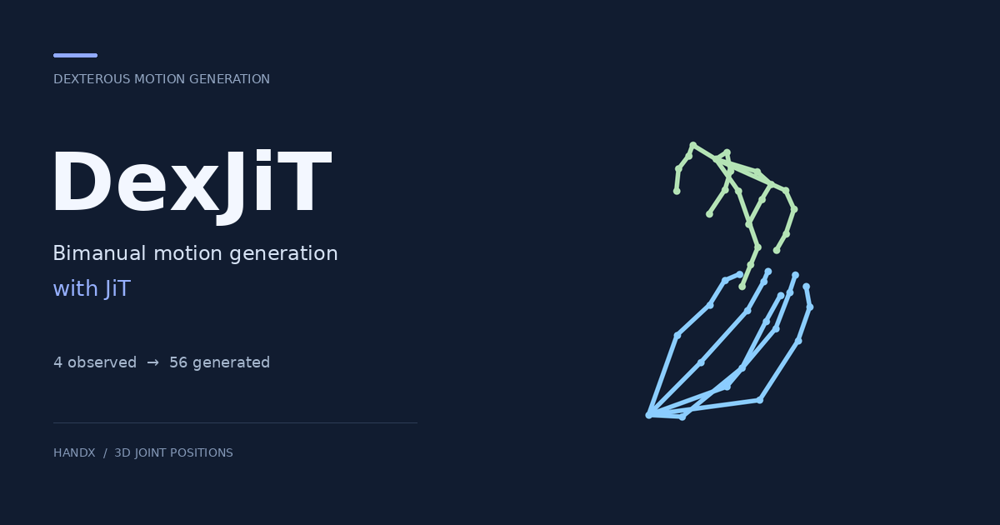
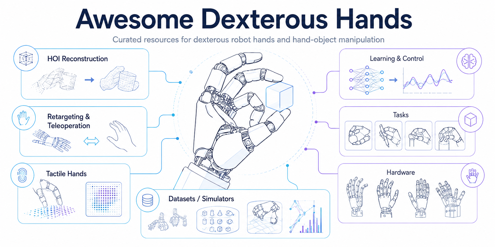
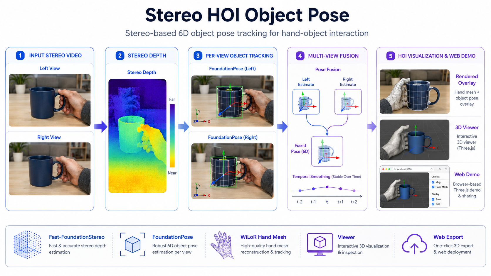



Here are some selected projects I have built or am maintaining.

  

    

      
    

    

      <h3 style="margin-top: 0; margin-bottom: 6px; font-size: 1.1em;">
        <a href="/projects/DexJiT/" style="text-decoration: none; color: #2c3e50;">DexJiT: Dexterous Motion Generation</a>
      </h3>
      
DexJiT compares clean-motion (x), velocity (v), and noise (ε) prediction for dexterous motion generation.

      
<a href="/projects/DexJiT/">Project page &#8599;</a>

    

  

  

    

      
    

    

      <h3 style="margin-top: 0; margin-bottom: 6px; font-size: 1.1em;">
        <a href="https://github.com/CyanHaze/Awesome-Dexterous-Hands" target="_blank" style="text-decoration: none; color: #2c3e50;">Awesome Dexterous Hands</a>
      </h3>
      

        A curated list of dexterous robotic hands — design paradigms, actuation, sensing, and benchmark tasks.
      

    

  

  

    

      
    

    

      <h3 style="margin-top: 0; margin-bottom: 6px; font-size: 1.1em;">
        <a href="https://github.com/CyanHaze/Stereo-Hoi-Object-Pose" target="_blank" style="text-decoration: none; color: #2c3e50;">Stereo HOI Object Pose Estimation</a>
      </h3>
      

        Stereo-based 6D object pose tracking for hand-object interaction videos.
      

    

  

